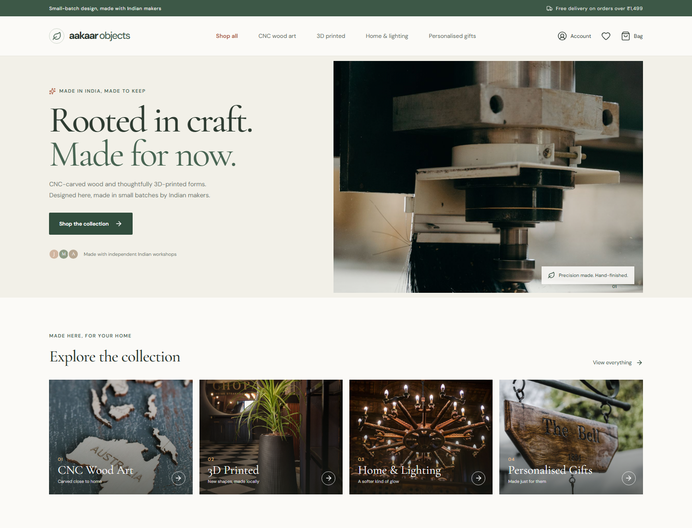
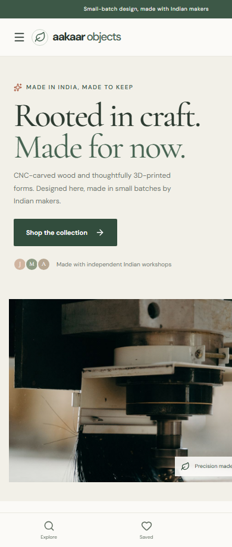

# Aakaar Objects

**A responsive Indian craft storefront, designed and built solo with React and TypeScript.**

Aakaar Objects is a polished e-commerce frontend concept for CNC-crafted wood art and 3D-printed home decor. It demonstrates reusable React components, custom hooks, product discovery, browser-persisted shopping state, responsive UI, and an INR checkout flow.

> This is a frontend portfolio demo. Sign-in and checkout are simulations; there is no backend, real authentication, payment processing, or order fulfilment.

## Screenshots

### Desktop



### Mobile



## Highlights

- **Shop and discover:** browse CNC wood art, 3D-printed objects, lighting, and personalised gifts.
- **Find the right piece:** search, filter by price and rating, sort, and paginate through products.
- **Explore products:** view product details, ratings, customer reviews, materials, and pricing in INR.
- **Shop interactively:** add items, adjust quantities, and manage a persistent wishlist and cart.
- **Try a complete demo flow:** sign in, enter Indian delivery details, place a simulated order, and view order history.
- **Designed for real screens:** responsive desktop, tablet, and mobile layouts, aspect-ratio-aware product photography, loading skeletons, and empty states.

## Built with

| Area | Technology |
| --- | --- |
| UI | React 19, TypeScript 6 |
| Build tooling | Vite 8 |
| Styling | Tailwind CSS 4 and project CSS |
| Icons | Lucide React |
| Persistence | Browser `localStorage` |
| Quality checks | TypeScript build and Oxlint |

## Component and code architecture

```text
src/
├── components/
│   ├── ProductCard.tsx       # Reusable, prop-driven product card
│   └── ProductGrid.tsx       # Product list, loading skeletons, and empty state
├── data/
│   └── products.ts           # Product catalog and category data
├── hooks/
│   ├── useCart.ts            # Cart state, totals, and quantity actions
│   ├── useProductCatalog.ts  # Search, filtering, sorting, and pagination data
│   └── useStoredState.ts     # Typed localStorage state with surfaced errors
├── types/
│   └── shop.ts               # Shared product, cart, order, and view types
├── utils/
│   └── money.ts              # Shared Indian rupee formatting
├── App.tsx                   # Page composition and storefront flows
├── App.css                   # Storefront and responsive component styling
└── index.css                 # Global styles and design tokens
```

`ProductCard` receives typed product data and action callbacks, so it can be reused without owning cart or wishlist state. `ProductGrid` composes the cards and gives loading, populated, and empty catalogs a consistent interface. Custom hooks keep persistence, cart calculations, and catalog transformations out of the presentation components.

## Run locally

**Requirements:** Node.js 20.19+ or 22.12+ and npm.

```bash
git clone https://github.com/<your-username>/aakaar-objects.git
cd aakaar-objects
npm install
npm run dev
```

Vite prints the local development URL after startup.

## Available scripts

| Command | Purpose |
| --- | --- |
| `npm run dev` | Start the Vite development server |
| `npm run lint` | Run Oxlint |
| `npm run build` | Run the TypeScript project build, then create a production bundle |
| `npm run preview` | Preview the production build locally |

## Demo behavior and limitations

- Cart, wishlist, demo customer, and order history are saved in this browser's `localStorage`.
- Delivery is free on orders of ₹1,499 or more and ₹99 below that threshold.
- Checkout validates Indian mobile numbers and PIN codes but does not submit or charge a payment.
- Product photography is illustrative stock imagery, not a verified photograph of an Aakaar-manufactured product. Images are stored locally in `public/products/`; photography sourced from Pexels is subject to the [Pexels license](https://www.pexels.com/license/).
- No API, database, production authentication, or payment provider is connected.

## Project checks

```bash
npm run lint
npm run build
```
